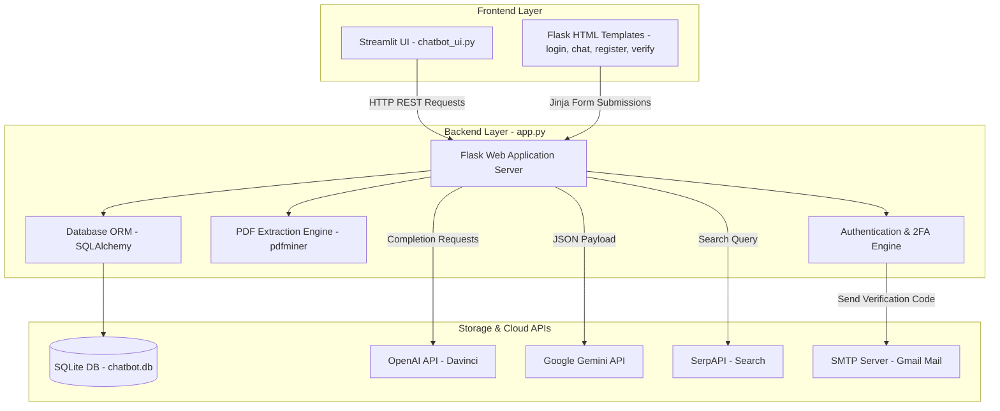

# 🛡️ GAILSPARTAN — Software Engineering Code Review & Architectural Analysis

## 📌 Executive Summary

**GAILSPARTAN** is an ambitious multi-model AI chatbot and document assistance platform built with Python, Flask, Streamlit, and SQLite. The project combines web search (SerpAPI), multi-LLM integrations (OpenAI & Gemini), PDF document text extraction, session-based user management, and 2-Factor Authentication (email verification).

While the overall vision of creating a central AI workspace pre-dates modern RAG platforms, the current codebase suffers from **syntax/runtime errors, deprecated API usage, security flaws, and incomplete template files** that prevent it from running without refactoring.

---

## 🔍 1. What Problem Were You Trying to Solve?

You were building a **Unified Multi-LLM Assistant & Document QA Platform**.
Specifically, the system was designed to address:
1. **Centralized AI Access Hub**: Bridging multiple AI backends (OpenAI text generation, Google Gemini, and live web search via SerpAPI) under a single customizable API.
2. **Document Ingestion (Early RAG)**: Extracting raw text from user-uploaded PDF files (`pdfminer.six`) and injecting that text context directly into prompt windows for instant document Q&A.
3. **Multi-User Access Control & Security**: Providing individual user registration, hashed password storage (`werkzeug.security`), session management, and email-based 2-Factor Authentication (2FA via `Flask-Mail`).
4. **Persistent Conversation History**: Tracking past interactions per user in an SQLite database table (`ChatHistory`).
5. **Dual Interface Options**: Offering both a traditional Flask server-side HTML template frontend and a rapid Streamlit web app interface.

---

## 🏗️ 2. What Did You Build? (Architecture & Components)



### Component Breakdown:
* **Backend API (`GAILSPARTAN/backend/app.py`)**:
  * Flask application serving REST API routes and Jinja2 templates.
  * `User` and `ChatHistory` database models using Flask-SQLAlchemy.
  * PDF processing pipeline via `pdfminer.six`.
* **Streamlit UI (`GAILSPARTAN/frontend/chatbot_ui.py`)**:
  * Streamlit frontend communicating with Flask backend via `requests`.
* **Flask Web Templates (`GAILSPARTAN/templates/`)**:
  * HTML forms for login, registration, code verification, and chat rendering.
* **Static Assets (`GAILSPARTAN/static/style.css`)**:
  * Minimal CSS styling for forms and layout.

---

## 🌐 3. Connectivity & Network Analysis

| Connection Type | Target / Technology | Status / Finding |
| :--- | :--- | :--- |
| **Database Connectivity** | SQLite (`sqlite:///chatbot.db`) via Flask-SQLAlchemy ORM | **Working concept**, but model creation `db.create_all()` is executed outside Flask application context. |
| **Streamlit $\leftrightarrow$ Flask** | HTTP (`http://127.0.0.1:5000`) via Python `requests` | **Hardcoded localhost URLs**. No retry logic, error handling, or environment configuration. |
| **Email SMTP Connectivity** | Gmail SMTP (`smtp.gmail.com:587` via TLS) | **Working pattern**, but relies on plain text email credentials in application source. |
| **OpenAI API Connectivity** | OpenAI SDK (`openai.Completion.create`) | **Broken/Deprecated**. Uses legacy Davinci models (`text-davinci-003`) retired by OpenAI. |
| **SerpAPI Connectivity** | HTTP GET (`https://serpapi.com/search`) | **Broken (Bug)**. Missing `import requests` and has variable name mismatch (`SERPAPI_KEY` vs `SERPAPI_API_KEY`). |
| **Gemini API Connectivity** | HTTP POST (`https://api.gemini.com/v1/...`) | **Broken Endpoint**. Points to Gemini crypto exchange domain rather than Google AI (`generativelanguage.googleapis.com`). |

---

## 🛑 4. How Good is the Code? (Critical Bugs & Security Code Review)

### 🔴 Critical Runtime Errors (Showstoppers)

1. **Missing `import requests` in `app.py`**:
   * Lines 95 & 105 call `requests.get(...)` and `requests.post(...)`, but `requests` is never imported in `app.py`. Invoking `/search` or `/gemini` causes an immediate `NameError`.
2. **Variable Mismatch in Search Endpoint**:
   * Line 36 defines `SERPAPI_API_KEY = '...'`, but line 94 attempts to access `SERPAPI_KEY` (`NameError`).
3. **Incorrect Gemini Endpoint URL**:
   * Line 105 posts to `https://api.gemini.com/v1/some_endpoint`. `api.gemini.com` is Gemini Crypto Exchange, not Google Gemini AI API.
4. **Deprecated OpenAI API**:
   * Uses `openai.Completion.create` with models `text-davinci-003` and `davinci-codex`, both of which are deprecated/shutdown. Modern OpenAI SDK (v1.0.0+) requires `from openai import OpenAI` and modern ChatCompletion models (`gpt-4o`, `gpt-4o-mini`).
5. **Incomplete Template Logic**:
   * `register.html` lacks `<input type="password">`, causing `request.form['password']` in `register()` to throw a `400 Bad Request`.
   * `chat.html` contains placeholder comments (`// ... (rest of the JavaScript code)`) in place of functional JavaScript.

---

### 🛡️ Security Vulnerabilities

1. **Hardcoded Sensitive Secrets**:
   * `SECRET_KEY`, `MAIL_USERNAME`, `MAIL_PASSWORD`, `openai.api_key`, `GEMINI_API_KEY`, and `SERPAPI_API_KEY` are all hardcoded inside `app.py`.
2. **Broken 2-Factor Authentication Flow**:
   * In `login()`, `session['user_id'] = user.id` is set **before** the verification code is sent or verified! A malicious actor can bypass 2FA by directly navigating to `/chat` once `/login` sets the session variable.
3. **Unauthenticated Public Endpoints**:
   * `/search`, `/openai`, and `/gemini` routes lack login checks, allowing unauthenticated external callers to consume your API rate limits and credits.

---

## 📊 5. Software Engineering Evaluation Metrics

```
+-------------------------------------------------------------------+
| Metric                        | Score  | Status                   |
+-------------------------------+--------+--------------------------+
| Architectural Concept         |  8/10  | Strong RAG & Hub vision  |
| Code Completeness             |  4/10  | Incomplete JS & forms    |
| Security & Authentication     |  3/10  | Vulnerable 2FA & secrets |
| Modern API Compliance         |  3/10  | Outdated SDKs & endpoints|
| Network Resilience            |  5/10  | Unhandled HTTP timeouts  |
| Code Quality & Maintainability|  4/10  | Monolithic structure     |
+-------------------------------+--------+--------------------------+
```

---

## 💡 6. Actionable Software Engineering Recommendations

### Step 1: Environment Security (`.env`)
Create a `.env` file and use `python-dotenv`:
```python
import os
from dotenv import load_dotenv
load_dotenv()

app.config['SECRET_KEY'] = os.getenv('SECRET_KEY')
OPENAI_API_KEY = os.getenv('OPENAI_API_KEY')
```

### Step 2: Fix Auth & 2FA Logic
Modify `app.py` so full user session is only granted *after* verification:
```python
# In login():
session['pending_user_id'] = user.id  # Pending status

# In verify():
if user and user.verification_code == code:
    session['user_id'] = session.pop('pending_user_id') # Promoted to logged in
```

### Step 3: Modernize AI Integrations
Upgrade OpenAI API to modern syntax and Google Gemini SDK:
```python
from openai import OpenAI
client = OpenAI(api_key=os.getenv("OPENAI_API_KEY"))

def generate_response(prompt):
    response = client.chat.completions.create(
        model="gpt-4o-mini",
        messages=[{"role": "user", "content": prompt}]
    )
    return response.choices[0].message.content
```

### Step 4: Streamline Project Structure
Rearrange files into a standard clean layout:
```text
GAILSPRATAN/
├── .env.example
├── requirements.txt
├── README.md
├── app.py
├── services/
│   ├── ai_service.py
│   └── pdf_service.py
├── templates/
├── static/
└── frontend/
    └── chatbot_ui.py
```
